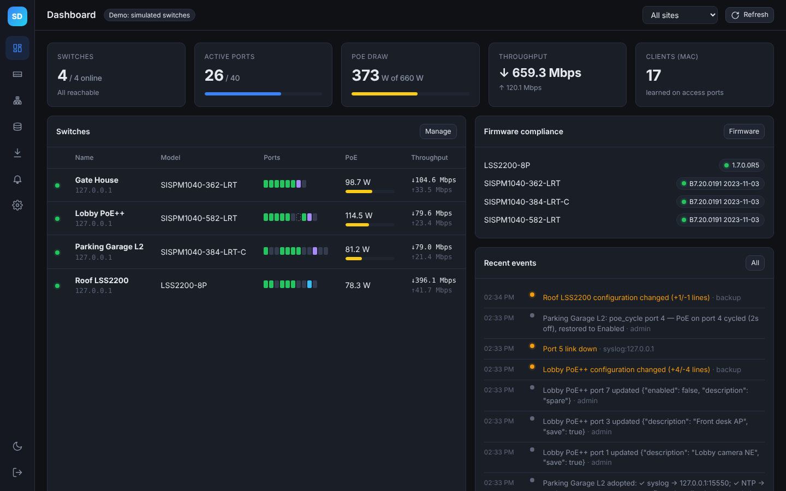
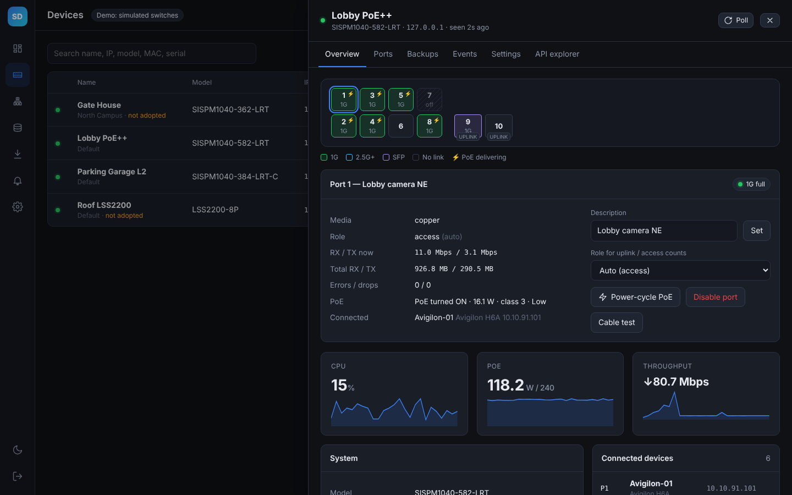
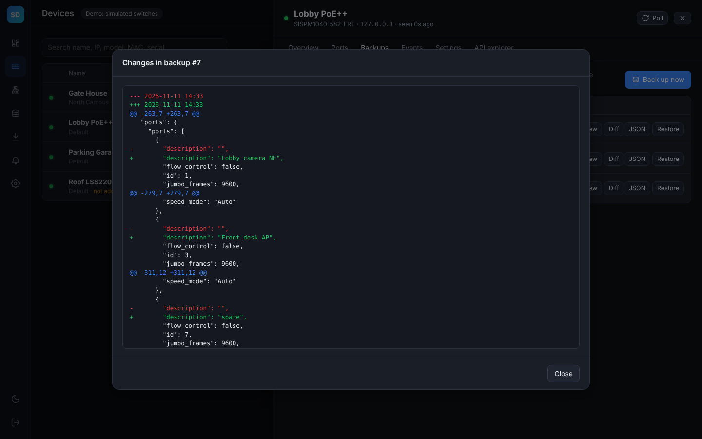
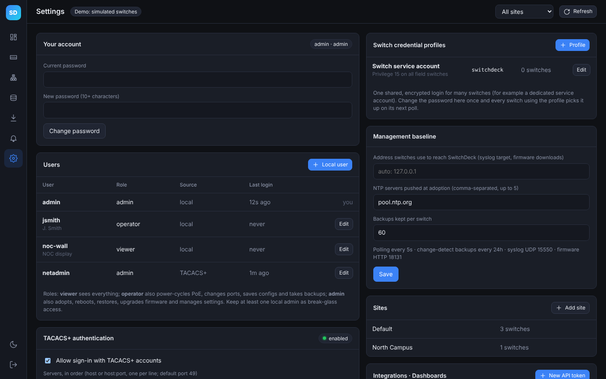

# SwitchDeck

An on-prem console for **Lantronix / Transition Networks** switches, in the spirit of Percepxion and the UniFi Network console. It monitors, configures, adopts, backs up and upgrades your switches. It also publishes a read-only roll-up API for dashboards such as Home Assistant.

| Family | Models | API used |
|---|---|---|
| SISPM1040 (unified API) | SISPM1040-582-LRT, SISPM1040-384-LRT-C, SISPM1040-362-LRT | `/api/*` JSON, session cookie `seid` (API User Guide 33824) |
| LS Series | LSS2200-8P | `https://<ip>:8000/rest/v1/*`, JWT bearer (REST API Guide 33863) |



| Device detail | Config diff | Settings |
|---|---|---|
|  |  |  |

More in the **[screenshot gallery](docs/screenshots/README.md)**.

The backend uses only the Python standard library (3.11+). `cryptography` is optional and is used for stronger credential encryption; the Docker image includes it.

---

## Install

On any Docker host or VM (needs Docker with the Compose plugin, plus `git` for the build fallback):
```bash
curl -fsSL https://raw.githubusercontent.com/schmittty/switchdeck/main/install.sh | sudo bash
```
For a lab dry run with four simulated switches, append `-s -- --demo`. Updating, settings, backups and other options are covered in [INSTALL.md](INSTALL.md).

**First sign-in:** `admin` / `admin`. You must choose a new password immediately. Local users with viewer / operator / admin roles, **TACACS+** sign-in (Cisco ISE, tac_plus, …), shared switch credential profiles and break-glass recovery are covered in **[docs/AUTHENTICATION.md](docs/AUTHENTICATION.md)**.

### From a clone (development)
```bash
cp .env.example .env
docker compose -f docker-compose.build.yml up -d --build   # build and run in Docker
SD_DEMO=1 SD_HTTP_PORT=8080 python3 -m app.main            # or run directly with Python 3.11+ (data goes to ./data)
```

| Port | Purpose |
|---|---|
| 8080/tcp | Web UI + API (TLS if `SD_TLS_CERT`/`SD_TLS_KEY` are set) |
| 8081/tcp | Plain HTTP, read-only firmware files that switches download during upgrades |
| 5514/udp | Syslog receiver; adoption points switches here |

---

## What it does

- **Dashboard.** Switches online, active ports, fleet PoE draw against budget, throughput, learned clients, firmware compliance, and recent events.
- **Devices.** UniFi-style list with port strips. Clicking a switch opens a drawer with:
  - **Overview:** a front-panel port map (PoE ⚡, SFP, uplink tags) and per-port details. Port actions are *power-cycle PoE*, *enable/disable*, *description*, *cable test*, and *uplink/access role*. The drawer also shows CPU, PoE and throughput sparklines, system info, and connected devices.
  - **Ports**, **Backups**, **Events**, **Settings** (inventory and on-switch name/location/contact), and an **API explorer** for raw, audited calls.
- **Adoption.** Pushes syslog → SwitchDeck and NTP, saves startup-config, and takes a baseline backup.
- **Discovery.** Sweeps a subnet (up to /22) for SISPM web/API signatures on 80/443 and LS REST on 8000. Hits land in *Pending adoption*.
- **Config backups.** Captures every config section through the API as normalized JSON with volatile fields stripped. Backups run on adoption, daily when something changed, before every restore, and before every firmware push. You can view them, diff any two, download them as JSON, or restore selected sections (SISPM). The IP section is opt-in.
- **Firmware.** Upload images to a library, check the version-compliance view, and push to selected switches one at a time. Each push takes a pre-upgrade backup and tracks progress.
- **Alerts and events.** Events cover online/offline, link up/down, PoE budget ≥90%, config drift, and syslog from the switches. A separate **audit log** records every user action.
- Sites, light/dark theme, and a phone-width layout.

---

## Dashboard integration (Home Assistant)

1. In **Settings → Integrations · Dashboards**, click **New API token**. Tokens are read-only and limited to `/api/v1/*`.
2. Add the token to Home Assistant `secrets.yaml`:
   ```yaml
   switchdeck_auth: "Bearer sdk_..."
   ```
3. Paste the RESTful sensor YAML shown on that page. It has a copy button and comes pre-filled with this server's address.

### `GET /api/v1/summary` (flat keys, built for one-line templates)
| Key | Meaning |
|---|---|
| `health` | `ok` / `degraded` (offline switch, uplink down, or errors in 24h) / `down` |
| `devices_total` `devices_online` `devices_offline` `devices_pending` | Switch counts |
| `ports_total` `ports_active` | All ports |
| `access_ports_total` `access_ports_active` | **Excludes uplinks.** Comparable to typical access-port counts on other vendor dashboards |
| `uplinks_total` `uplinks_up` `uplinks_down` | Uplinks in use; empty SFP cages count as spare, not down |
| `poe_used_w` `poe_budget_w` `poe_pct` `poe_ports_powered` | PoE |
| `cameras` `clients` `rx_mbps` `tx_mbps` | Attached cameras (DMS device list), MACs, throughput |
| `backups_current` `backups_stale` `config_changes_24h` `alerts_24h` `errors_24h` | Ops hygiene |
| `firmware_mismatch_models`, `firmware{model:[versions]}` | Compliance |
| `model_<slug>_{total,online,ports_active,access_ports_active}` | Per-model flat keys, e.g. `model_sispm1040_582_lrt_online` |
| `offline_devices`, `models`, `sites`, `devices[]` | Lists and objects for tables |

The API also serves `GET /api/v1/devices` (per-switch rows) and `GET /api/v1/events?hours=24` (warnings and errors).

**Uplink rule:** a port is an uplink if it is SFP/fiber, its description contains "uplink" or "trunk", or its neighbor is another switch. You can override any port in the device drawer by setting its *Role for uplink / access counts*.

---

## Lab test checklist

The SISPM driver follows the published API guide exactly. A few behaviors can only be confirmed on real hardware:

1. **SISPM login.** Confirm that adding a SISPM1040 switch reaches *online*. The client chooses the session ID and sends it as cookie `seid=<id>`. If login fails, check that the firmware is at least B7.20.0039 on the -582.
2. **LS Series (LSS2200-8P).** The guide does not print the login path or most response field names. The driver tries `login/` and similar paths with `username`/`password`, then reads the switch's own Swagger schema. Open **API explorer** on the LS switch and run `GET swagger.json`, `sysinfo/`, and the port and PoE endpoints. If names differ, adjust `CANDIDATES` at the top of `app/drivers/lss.py`. Restore stays disabled for LS until the write calls are confirmed.
3. **PoE cycle.** Cycle a non-critical port and confirm the PD reboots and the mode returns to its original value.
4. **Restore.** Change a port description, back up, restore the earlier snapshot, and diff.
5. **Firmware.** Set **Settings → Address switches use to reach SwitchDeck** to the host's management IP before pushing. Switches download from `http://<that IP>:8081/fw/...`.
6. **Syslog.** After adoption, link-flap a port and watch *Alerts & Events*.
7. **Dashboard API.** `curl -H "Authorization: Bearer sdk_..." http://<host>:8080/api/v1/summary`

## Layout
```
install.sh             installer / updater (pulls ghcr.io/schmittty/switchdeck, or builds from this repo)
docker-compose.yml     production compose (published image); docker-compose.build.yml builds from source
.github/workflows/     builds and publishes the multi-arch image on every push to main
app/main.py            entry point (db init, admin bootstrap, demo, background services)
app/server.py          HTTP server, REST API, dashboard roll-up, firmware file server
app/drivers/           base.py (HTTP client, normalized model), sispm.py, lss.py
app/services/          manager.py (poller, backups, diffs), discovery.py, syslogd.py, jobs.py
app/tacacs.py          TACACS+ client (RFC 8907); app/cli.py break-glass admin commands
docs/AUTHENTICATION.md sign-in, roles, TACACS+, switch credentials, recovery
app/web/               index.html, app.js, styles.css (no build step)
tools/mock_switch.py   protocol-level simulators for SISPM1040 and LSS2200; tools/mock_tacacs.py test TACACS+ server
```

## Security notes
See [docs/AUTHENTICATION.md](docs/AUTHENTICATION.md) for the full picture.
- Sign-in uses local accounts and/or TACACS+, with three roles (viewer, operator, admin) enforced server-side. The default `admin`/`admin` must be changed at first sign-in. Failed sign-ins are throttled, and every action is audited.
- Switch passwords (per switch or shared credential profiles) are encrypted at rest with a key in `/data/secret.key`. Back up the volume as a whole.
- UI sessions use HttpOnly SameSite=Strict cookies. Write calls also require an `X-Requested-With` header (CSRF guard). Local passwords are hashed with PBKDF2 (310k rounds).
- API tokens are stored only as SHA-256 hashes and can read only `/api/v1/*`.
- The firmware port serves only unguessable `/fw/<token>/<file>` paths.

## Roadmap
SNMP polling as a fallback for firmware without the API · SSH CLI for running-config text · port profiles and VLAN templates pushed fleet-wide · DHCP option 66/67 ZTP · RADIUS/LDAP sign-in · email/webhook alerting.
