# SwitchDeck screenshots

All screenshots use the built-in demo mode (`SD_DEMO=1`): four simulated switches, one of each supported model.

## Dashboard
Fleet health at a glance: switches online, active ports, PoE draw against budget, throughput, firmware compliance and recent events.

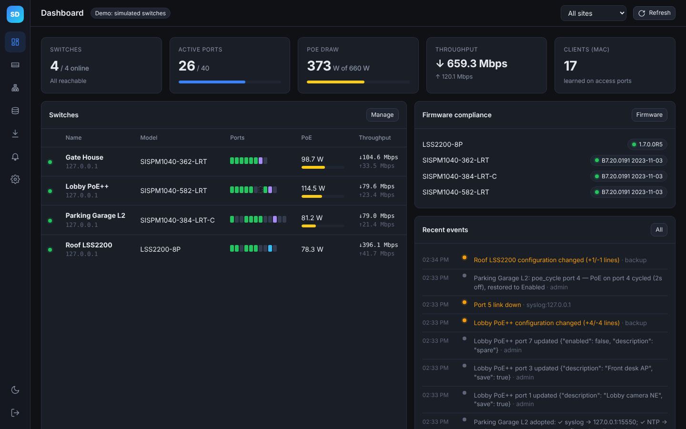

Light theme:

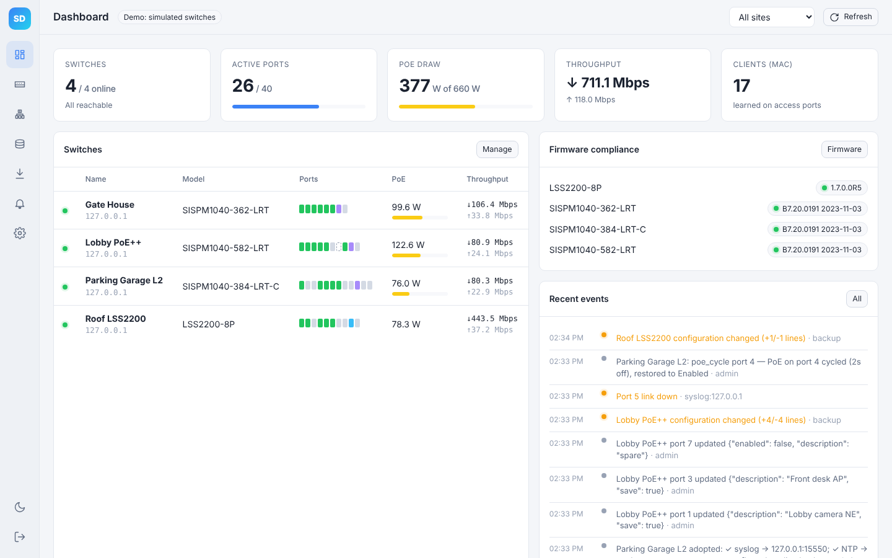

## Devices
Every switch with status, model, firmware, a live port strip, PoE, CPU/temperature, uptime and last backup.

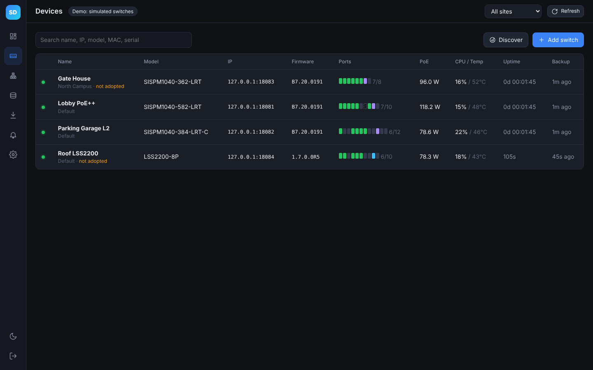

## Device detail
Front-panel port map (⚡ PoE delivering, SFP and uplink tags, disabled ports hatched). Clicking a port shows its traffic, PoE, connected device and actions: power-cycle PoE, enable/disable, description, cable test and uplink/access role.

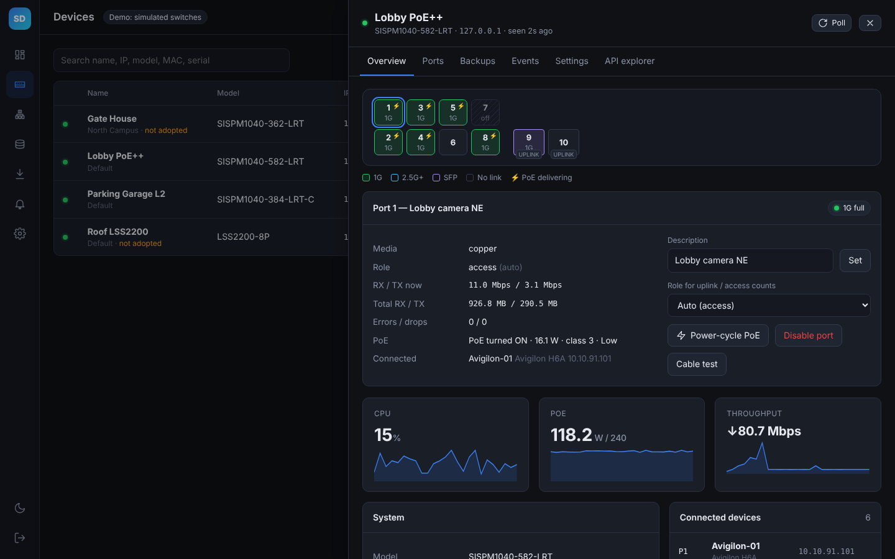

Per-port table:

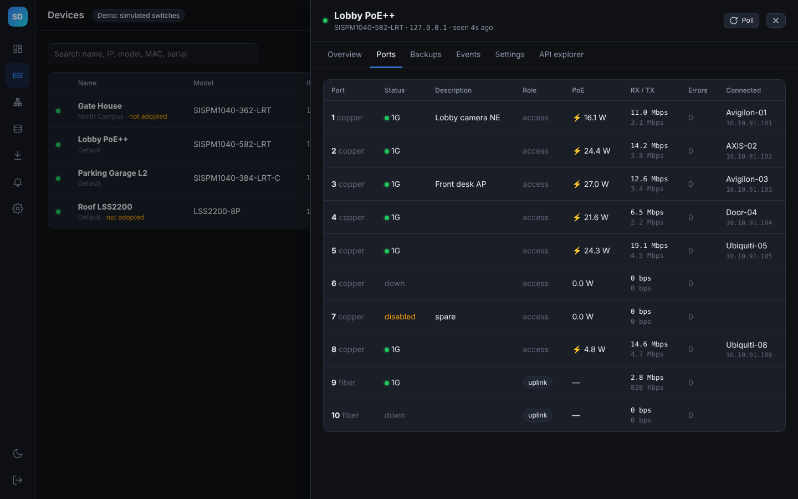

## Configuration backups
Normalized JSON snapshots with a diff between versions; restore by section.

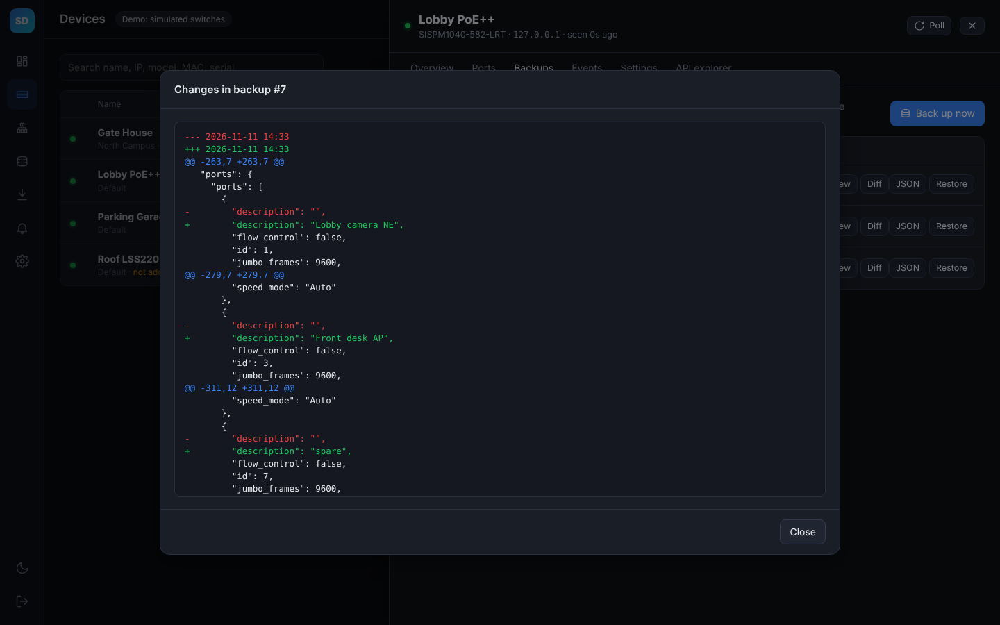

## Topology
Switches and their connected devices, from each switch's neighbor table.

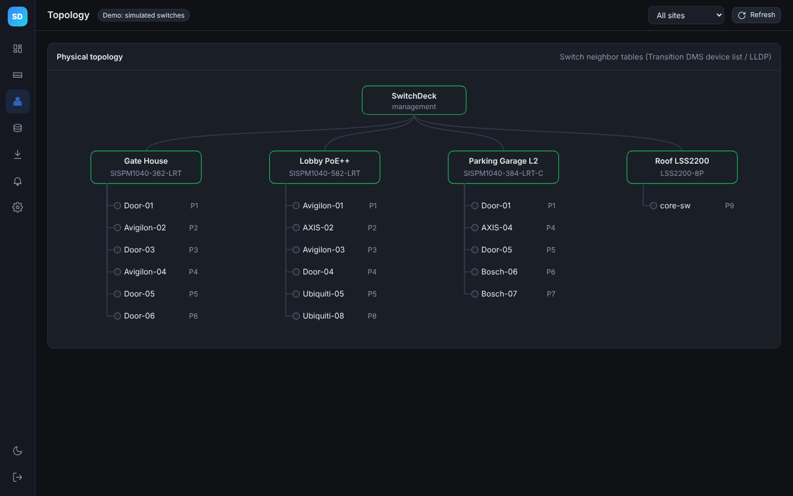

## Firmware
Version compliance by model, an image library, and one-at-a-time upgrades.

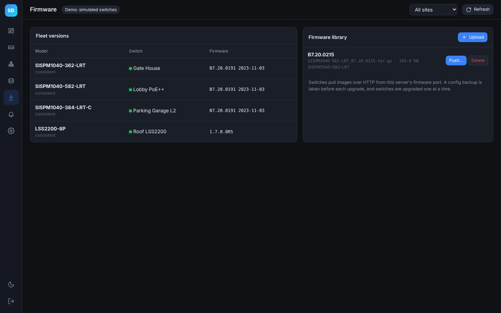

## Alerts & events
Link changes, configuration drift, syslog from the switches and user actions. A separate tab holds the audit log.

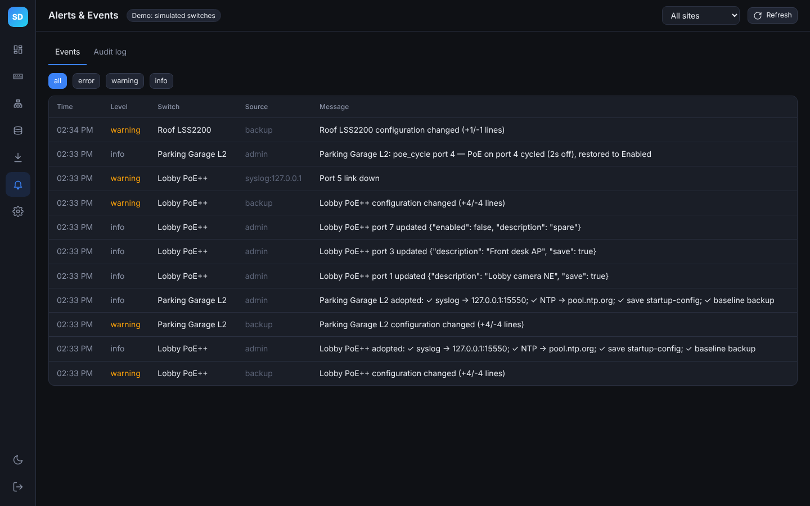

## Settings
Users and roles, TACACS+ sign-in, shared switch credential profiles, management baseline, sites, and read-only API tokens for dashboards.

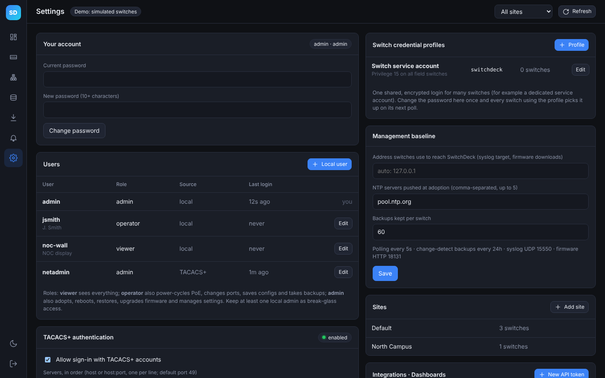

## Sign-in and mobile

| Sign-in | Phone width |
|---|---|
| 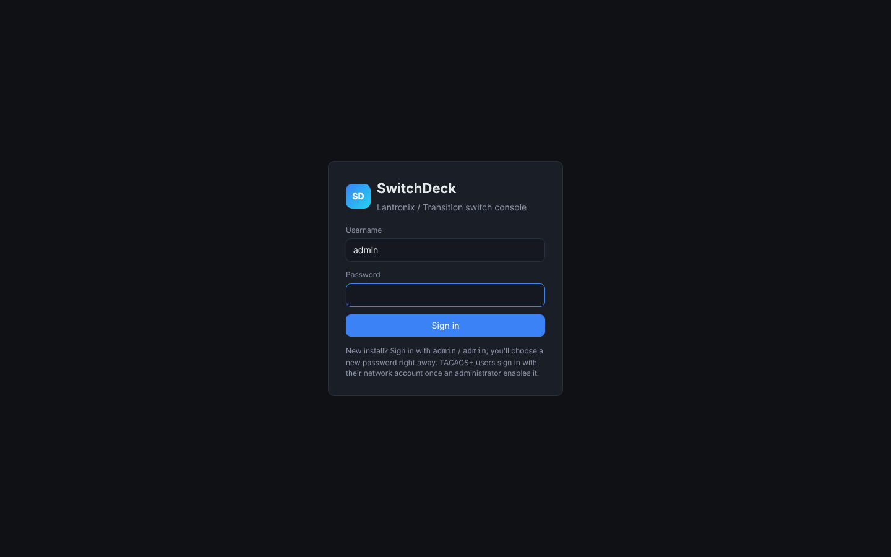 | 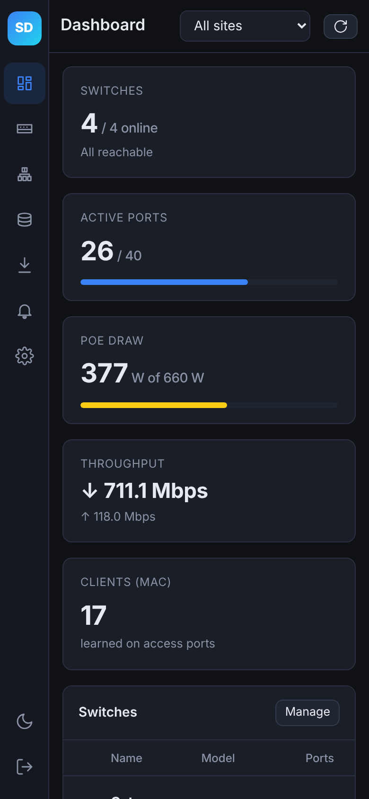 |
